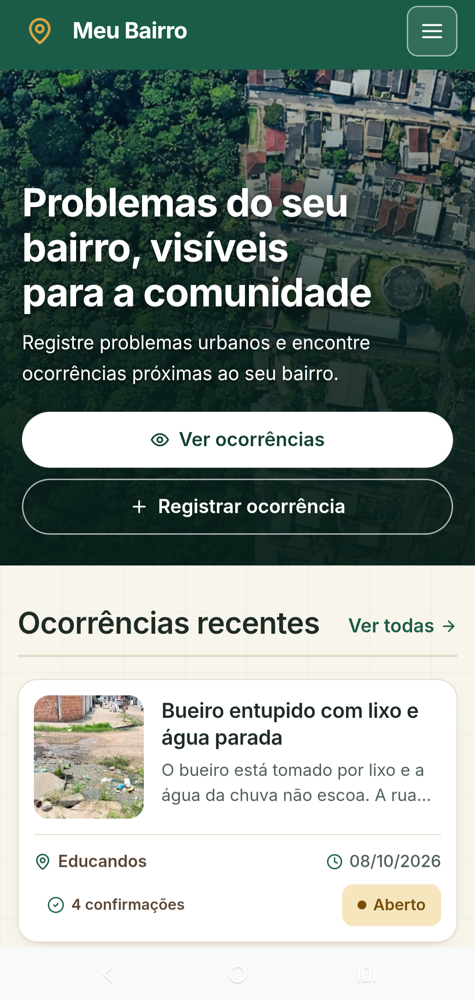
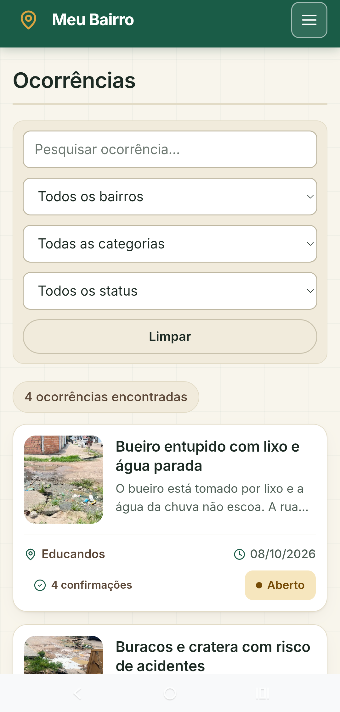
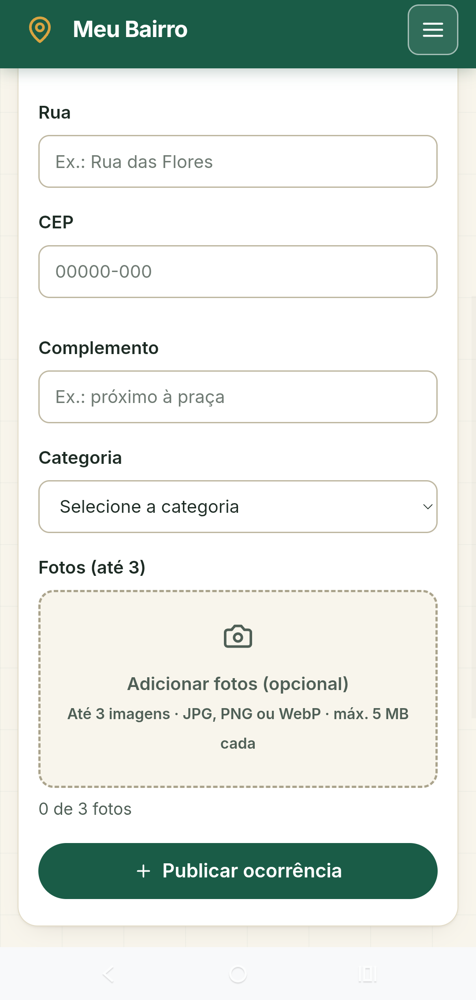
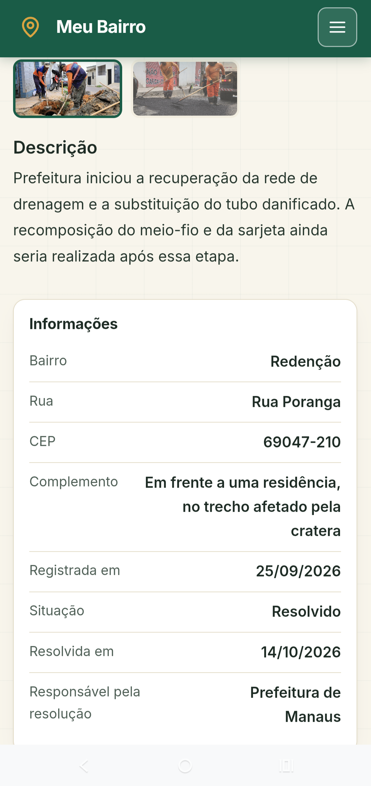
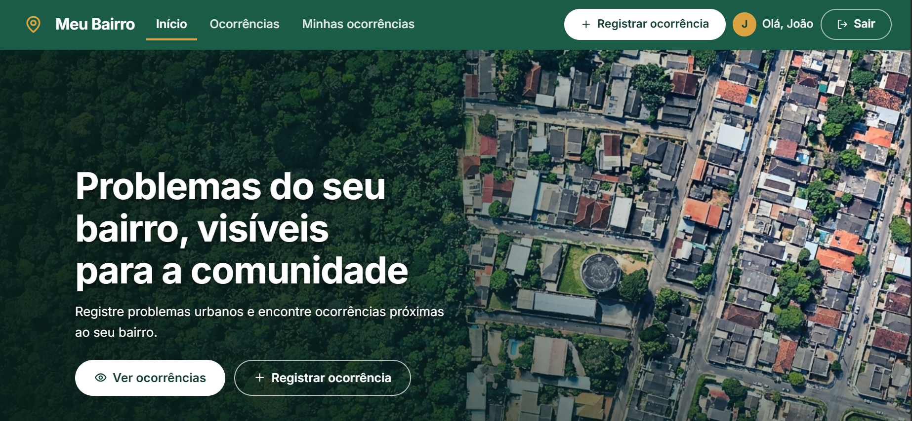
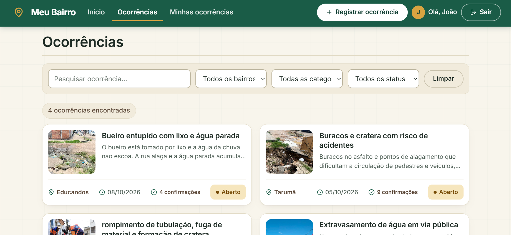
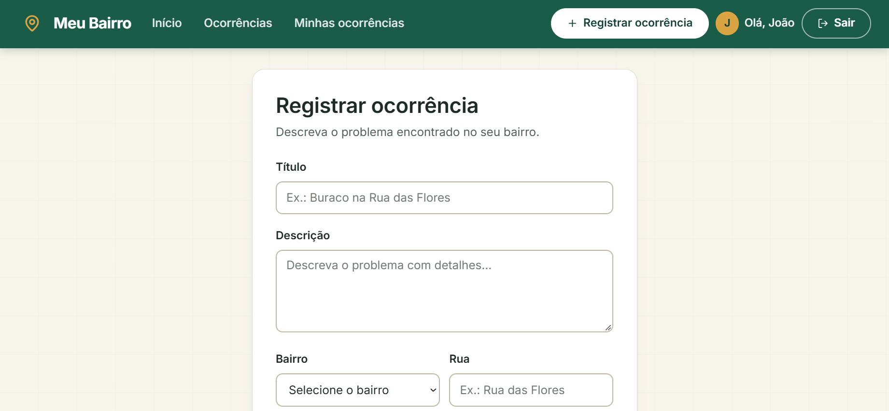
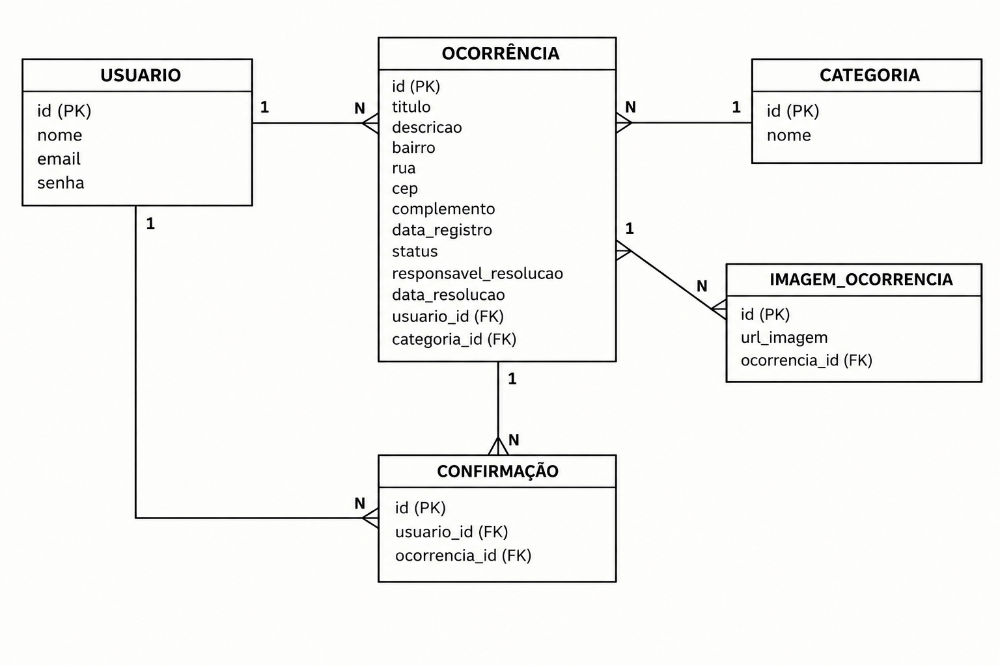

# Meu Bairro — Sistema de Registro de Ocorrências Urbanas

[](https://github.com/guilhermenoe2020-netizen/projeto-meu-bairro/blob/main/LICENSE)

## Sobre o projeto

**[Acessar aplicação online](https://meu-bairro.netlify.app)** · **[Ver demonstração](https://meu-bairro-demo.netlify.app)**

O **Meu Bairro** é uma aplicação full stack web e mobile desenvolvida como projeto acadêmico do curso de Análise e Desenvolvimento de Sistemas, com o objetivo de facilitar o registro e a consulta de problemas urbanos em Manaus.

A proposta é permitir que os cidadãos registrem ocorrências de seus bairros, relacionadas à infraestrutura urbana, como buracos nas vias públicas, descarte irregular de lixo, problemas na iluminação pública e alagamentos.

O sistema está sendo desenvolvido com uma arquitetura composta por uma interface web, uma API REST e um banco de dados relacional. A aplicação busca centralizar informações sobre problemas urbanos, facilitar sua consulta e permitir que usuários contribuam confirmando ocorrências já registradas.

### Layout mobile

<table>
  <tr>
    <td align="center">
      <strong>Tela inicial</strong><br>
      
    </td>
    <td align="center">
      <strong>Consulta de ocorrências</strong><br>
      
    </td>
  </tr>
  <tr>
    <td align="center">
      <strong>Registro de ocorrência</strong><br>
      
    </td>
    <td align="center">
      <strong>Detalhes da ocorrência</strong><br>
      
    </td>
  </tr>
</table>

## Layout web

<table>
  <tr>
    <td align="center">
      
    </td>
    <td align="center">
      
    </td>
  </tr>
</table>

<p align="center">
  <strong>Registro de ocorrência</strong><br>
  
</p>

## Modelo relacional



## Tecnologias utilizadas

### Back-end

- Java 25
- Spring Boot
- Spring Web
- JPA / Hibernate
- Maven

### Front-end

- HTML5
- CSS3
- JavaScript

## Conceitos e práticas aplicados

- **Desenvolvimento incremental:** evolução do sistema por etapas, com implementação gradual de funcionalidades.
- **Desenvolvimento de API REST:** criação de endpoints para consulta e registro de informações.
- **Persistência de dados:** utilização de JPA/Hibernate para mapear entidades Java e integrá-las ao MySQL.
- **Modelagem relacional:** definição das entidades e dos relacionamentos do banco de dados.
- **Integração entre front-end e back-end:** comunicação entre a interface web e a API.
- **Versionamento de código:** uso de Git e GitHub para acompanhar as alterações do projeto.
- **Implantação de aplicações:** publicação do front-end e do back-end em ambientes de hospedagem.

### Implementação em produção

- Back end: Render
- Front end: Netlify
- Banco de dados: Mysql

# Como executar o projeto

## Back end
Pré-requisitos: Java 25

```bash
#clonar repositório
git clone https://github.com/guilhermenoe2020-netizen/projeto-meu-bairro.git

# entrar na pasta do projeto back end
cd projeto-meu-bairro/backend

#excutar o projeto
./mvnw spring-boot:run
```
## Front-end web

**Pré-requisitos:** navegador web e editor de código, como o Visual Studio Code.

1. Clone o repositório.
2. Abra a pasta do front-end no Visual Studio Code.
3. Abra o arquivo `index.html` no navegador.
 
## Etapas de desenvolvimento

O desenvolvimento do Meu Bairro está organizado em etapas:

1. Levantamento do problema e definição dos requisitos.
2. Modelagem conceitual e relacional do banco de dados.
3. Prototipação das telas da aplicação.
4. Desenvolvimento da API REST.
5. Integração com o banco de dados.
6. Integração entre front-end e back-end.
7. Implementação das funcionalidades de autenticação e confirmação.
8. Testes, ajustes e documentação.

## Próximas melhorias

- **Aprimorar o cadastro e a autenticação:** implementar a verificação de e-mail por link de confirmação, estabelecer requisitos mínimos de segurança para as senhas e adicionar a opção de mostrar ou ocultar a senha.
- **Recuperação de senha:** implementar o fluxo de recuperação de acesso por e-mail.
- **Organização e refatoração do código:** revisar a estrutura do projeto, eliminar duplicações e melhorar a legibilidade e a manutenção do código.
- **Tratamento de exceções no back-end:** aprimorar o tratamento de erros e padronizar as respostas da API.
- **Correção de falhas no registro de ocorrências:** investigar e corrigir o problema que, após determinado tempo de uso, impede o cadastro de novas ocorrências até que a página seja acessada novamente.
- Desenvolver testes para os principais fluxos da aplicação.

## Agradecimentos

Projeto desenvolvido como parte da formação acadêmica em Análise e Desenvolvimento de Sistemas, com o objetivo de aplicar conhecimentos de desenvolvimento web, programação Java e bancos de dados relacionais.
